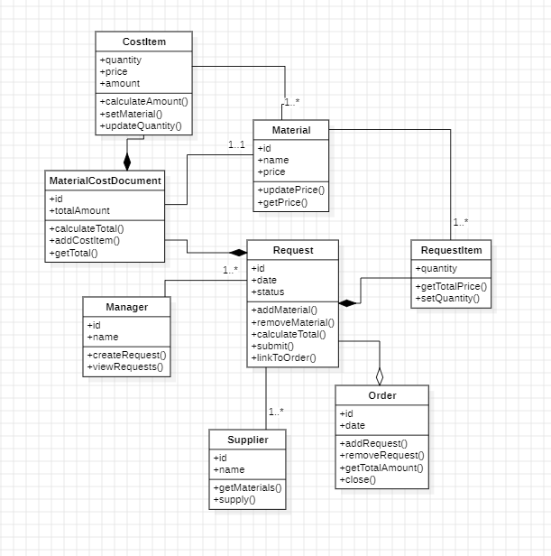
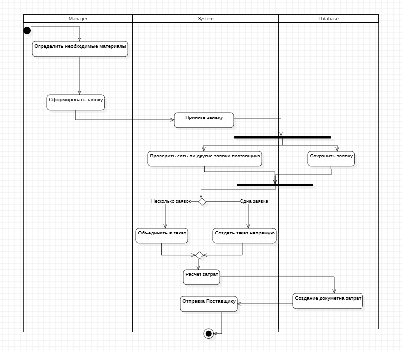
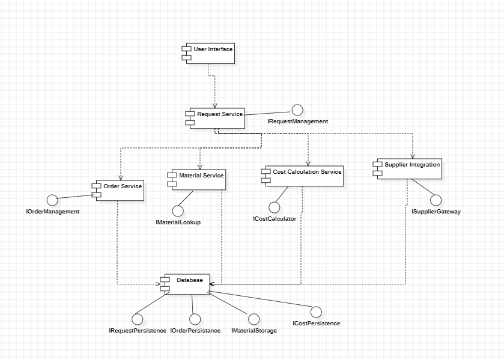
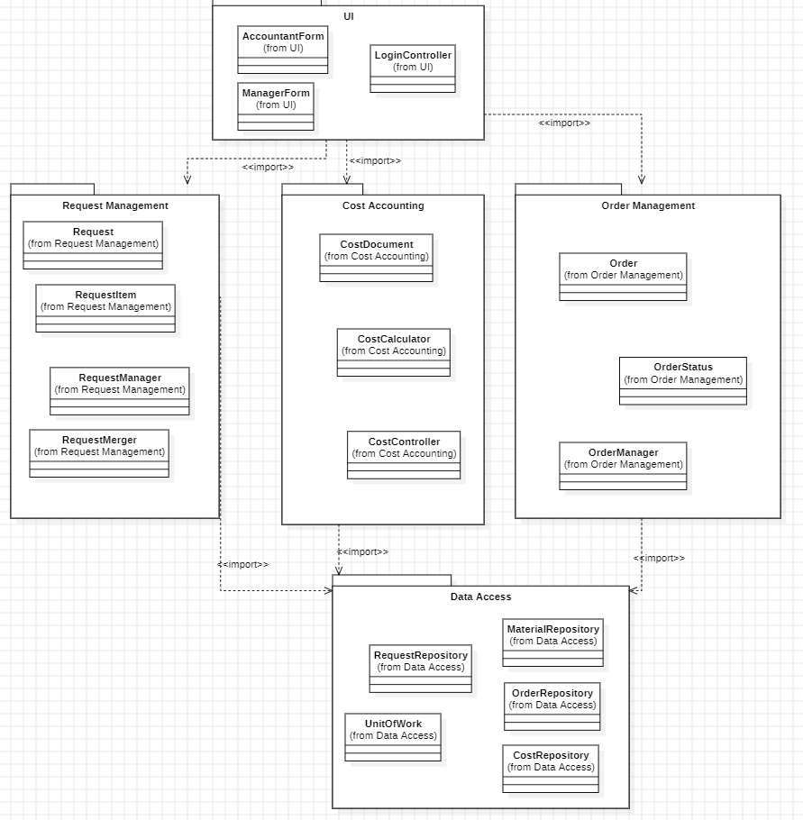

# Аукционная система (UML)

**Роль:** Системный аналитик.

В рамках учебного проекта спроектирована информационная система для проведения закупок и аукционов. Разработан полный комплект проектной документации с использованием нотации UML (StarUML).

## Реализованные артефакты

- **Use Case (Варианты использования)** — роли: Менеджер по закупкам, Бухгалтер. Сценарии: формирование заявки, расчет затрат, просмотр заказов.
- **Диаграмма классов** — модель данных: пользователи (Manager), материалы (Material), заявки (Request), заказы (Order), поставщики (Supplier).
- **Диаграмма деятельности** — процесс обработки заявки (дорожки: Manager, System, Database).
- **Диаграмма компонентов** — архитектура: UI, Request Service, Material Service, Cost Calculation Service, Database.
- **Диаграмма пакетов** — логическая структура: UI, Request Management, Cost Accounting, Order Management, Data Access.

## Просмотр диаграмм

### 1. Use Case (Варианты использования)

### 2. Диаграмма классов

### 3. Диаграмма деятельности

### 4. Диаграмма компонентов

### 5. Диаграмма пакетов

